# Mailophant

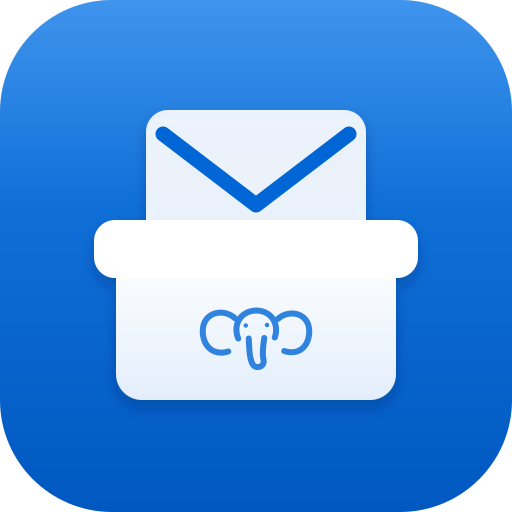

**Remembers your mail (like an elephant 👀). Mailophant keeps your Proton Mail
exports and old Outlook files in one local library, where you can read, search,
tag and archive them.**

[](LICENSE)


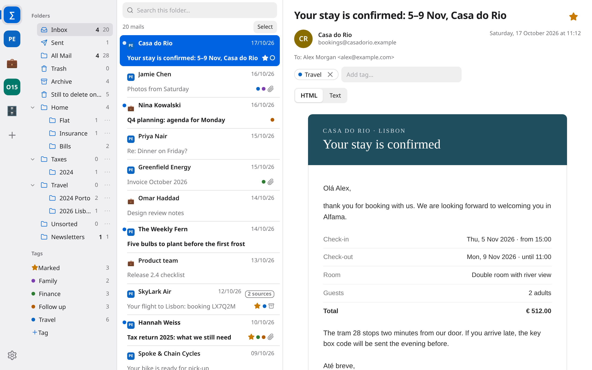

## What it is

Mail piles up in places you no longer use. A Proton account gets exported every
few months, a work address ends with the job, and a `.pst` file from 2015 sits
on an old drive. Mailophant puts all of them into one library and shows them
like a normal mail client: sources on the left, then folders, the message list
and the reader.

It runs on your own machine. The server listens on `127.0.0.1` only, nothing is
uploaded, and your exported mail files are only read. Mailophant writes to its
own archives, and to an Outlook import when you run the duplicate cleanup.

## Highlights

### Every backup in one mailbox

A library holds any number of sources: Proton accounts (the folder the export
tool writes to), single Proton export folders and imported Outlook `.pst` or
`.ost` files. The ∑ view shows them as one mailbox. If the same mail turns up in
several backups, it appears once with a "2 sources" badge, and the reader shows
where each copy lives and lets you switch between them.

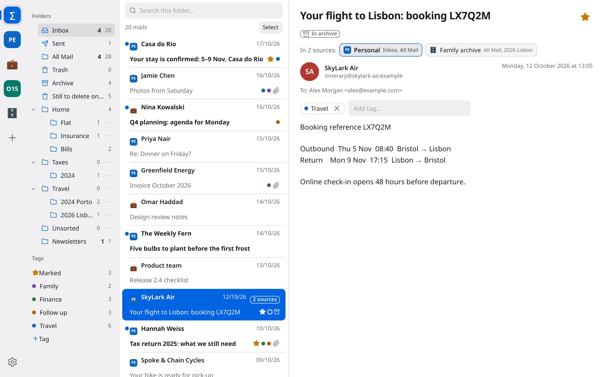

New mail comes straight from Proton. Mailophant runs the official
[Proton Mail Export CLI](https://proton.me/support/proton-mail-export-tool) for
you, with 2FA and two-password mode. Passwords are never stored and are hidden
in the log. Mails that did not change since the last fetch are hardlinked to
the previous export, so a new fetch only costs the space of new mail.

### Archives that keep what Proton deletes

You can create your own archives with nested folders, rename and reorder them
by drag and drop, and move or copy mails into them one at a time or in a batch.

Give a Proton account a target archive and Mailophant will look for mails that
disappeared online after each fetch. They are copied into the archive's
"Unsorted" folder before the old exports are deleted. If an unusually large
share of mail goes missing at once, it stops and asks first. An original is
removed only once its copy is complete, and every write goes through a temp
file and an atomic rename, so hardlinked exports never change under you.

<table>
  <tr>
    <td width="50%">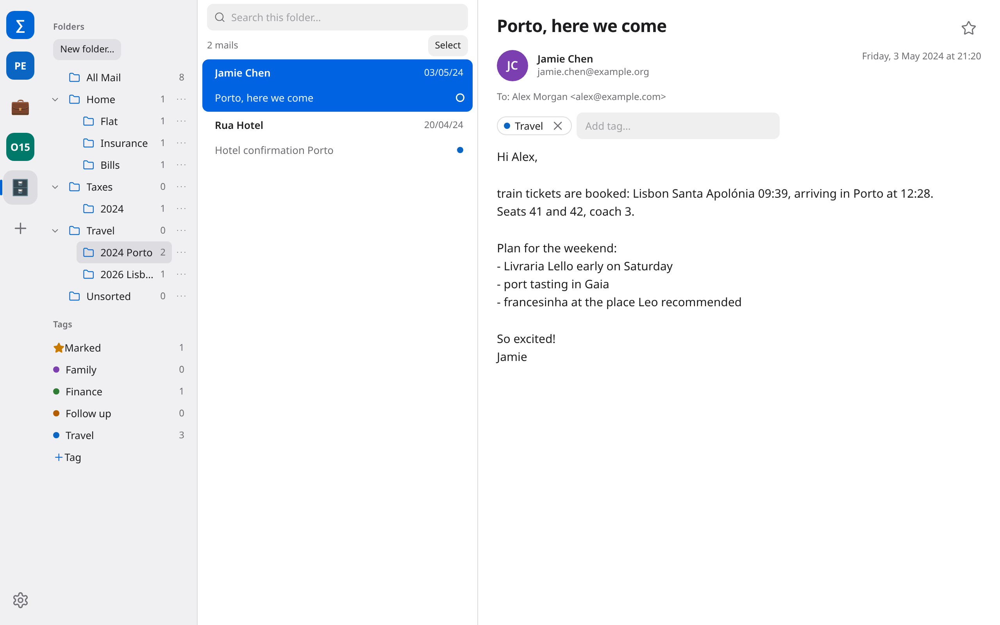<br><sub><b>Archive</b>: your own folders, sorted by drag and drop</sub></td>
    <td width="50%">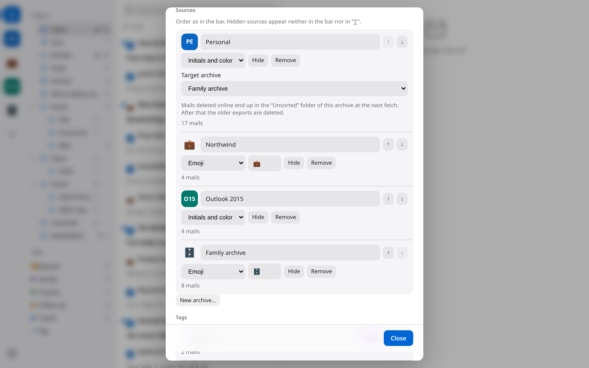<br><sub><b>Settings</b>: icons, order and the target archive per source</sub></td>
  </tr>
</table>

### Search, stars and tags

Full-text search covers subjects, senders and recipients across every source,
and it handles umlauts and other non-ASCII letters. You can search one folder,
one tag or all mail.

Stars and coloured tags are stored per mail, keyed by its Message-ID. They
survive a new fetch or a rebuilt index and show up on every copy of the mail in
every source. Press <kbd>s</kbd> to star the open mail.

<table>
  <tr>
    <td width="50%">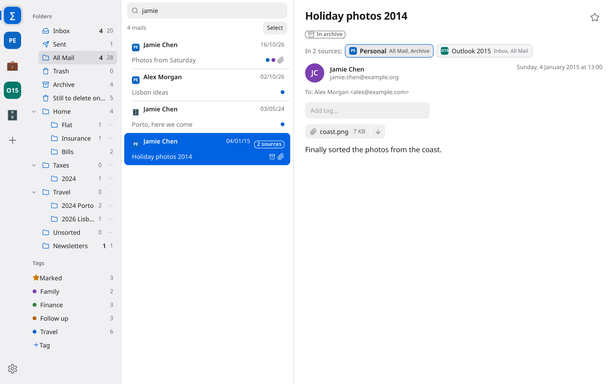<br><sub><b>Search</b>: one query over all sources</sub></td>
    <td width="50%">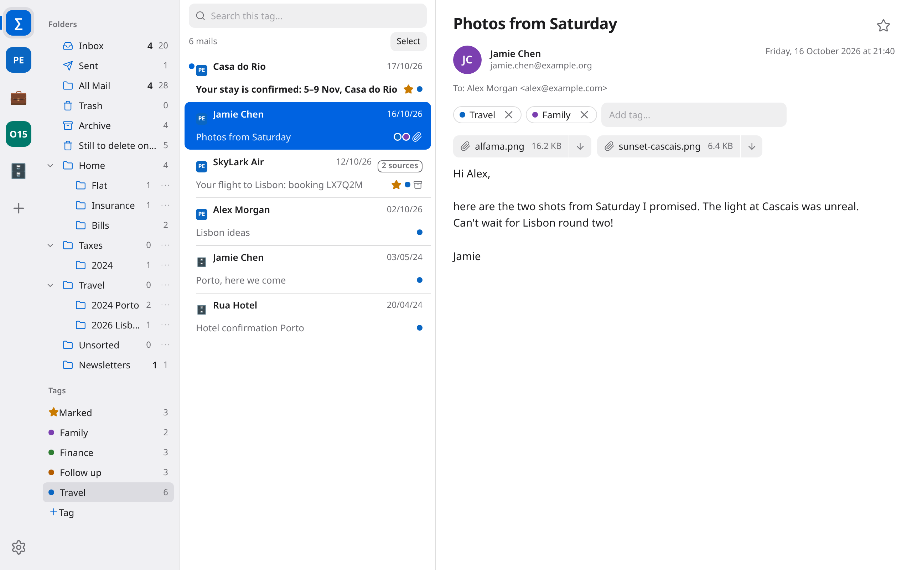<br><sub><b>Tags</b>: filter by tag in the sidebar</sub></td>
  </tr>
</table>

### Attachments in place

PDFs, images and MP3 files open in a preview inside the app, and a button next
to each attachment downloads it. HTML mail shows its inline images.

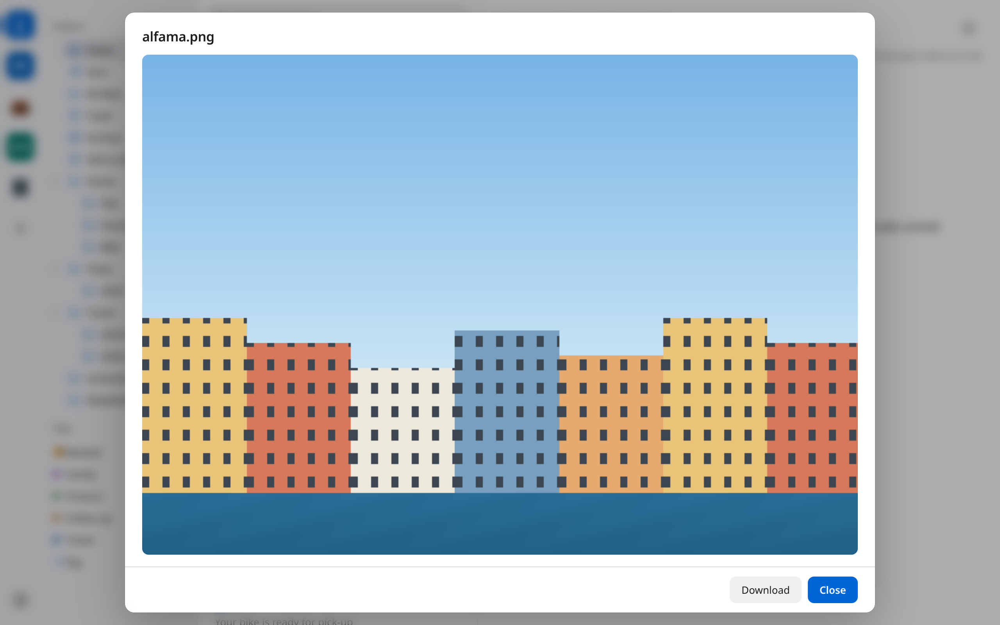

### Safe HTML mail

HTML mail is rendered in a sandboxed frame with a strict Content Security
Policy. Scripts do not run and remote images are not loaded, so tracking
pixels never report back.

### Duplicate cleanup

An Outlook import often repeats mail you already have from Proton. The cleanup
replaces those copies with hardlinks, so they stay visible but take no extra
space, or deletes them. You see a preview first, confirm, and get a log file
for each run.

### Light, dark, narrow

Mailophant follows the system appearance or a setting of your choice. It
speaks English and German and switches without a restart. You can move through
the list with <kbd>j</kbd> and <kbd>k</kbd> or the arrow keys. On a narrow
window the panes stack, and a swipe from the edge or <kbd>Esc</kbd> takes you
back.

<table>
  <tr>
    <td width="60%">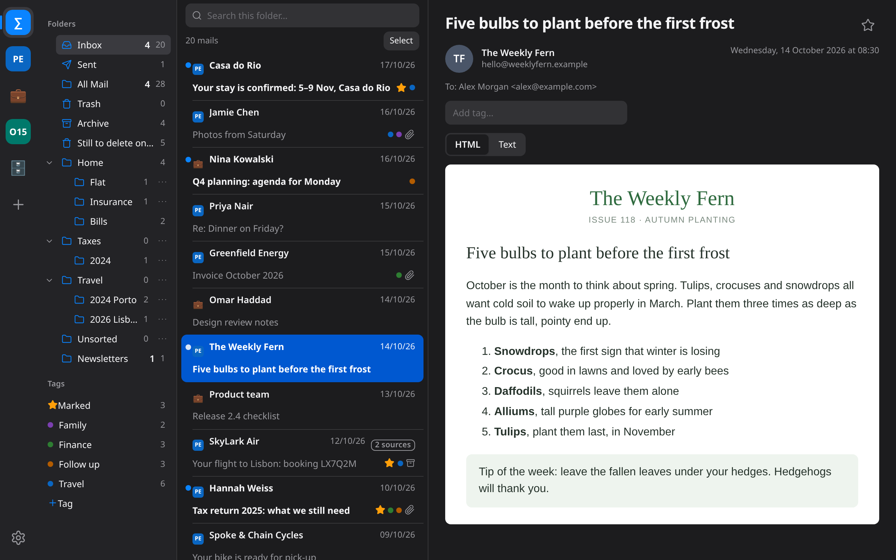<br><sub><b>Dark</b>: follows the system or the setting</sub></td>
    <td width="20%">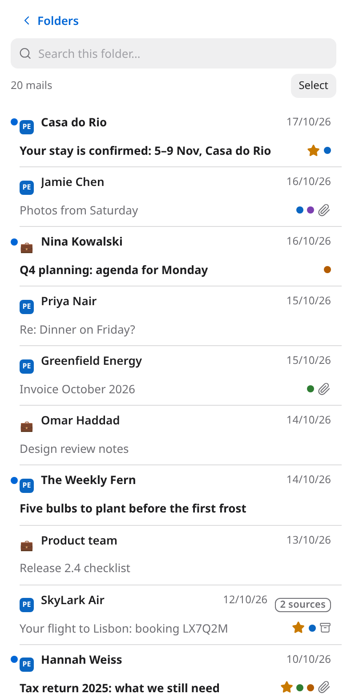<br><sub><b>Narrow</b>: list</sub></td>
    <td width="20%">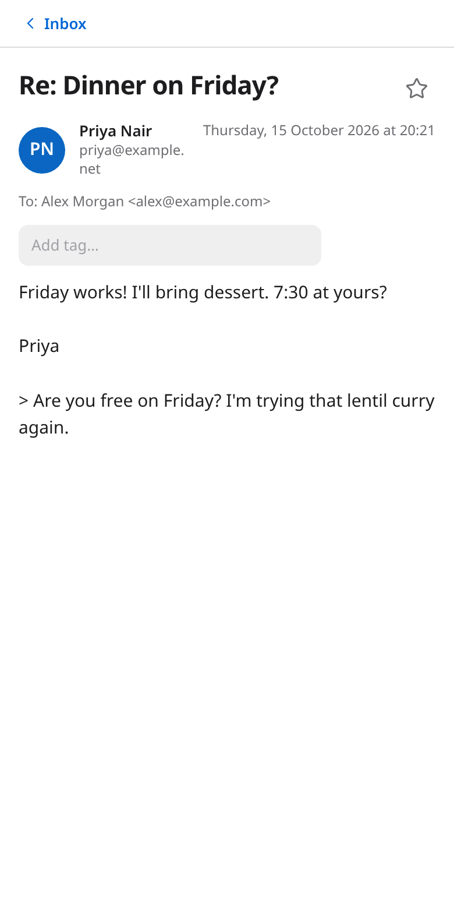<br><sub><b>Narrow</b>: reader</sub></td>
  </tr>
</table>

## Getting started

### Desktop app

```bash
git clone <repo-url> mailophant
cd mailophant
./start.sh
```

On the first run `start.sh` installs the Electron dependencies and opens the
app. The app then looks for Python 3.10 or newer, creates a virtual environment
and installs Outlook support (`libpff-python`) into it.

Choose a folder for your library, or create a new one, and add your first
source with **＋**.

### Server only

The core of Mailophant is a Python server that needs nothing beyond the
standard library. You can run it without Electron and use any browser:

```bash
./start.sh --server [--port 8025] [LIBRARY_DIR]
# or
python3 -m mailviewer [LIBRARY_DIR] --port 8025
```

Then open <http://127.0.0.1:8025/>.

### Optional extras

| Feature | Requirement |
| --- | --- |
| Fetch from Proton | [Proton Mail Export CLI](https://proton.me/support/proton-mail-export-tool). **Settings → Proton fetch → Install CLI** downloads it from proton.me into Mailophant's data folder. You can also set its path in the settings, pass `--cli PATH`, or set `PROTON_EXPORT_CLI`. |
| Import Outlook `.pst`/`.ost` | Python module `pypff` (`pip install libpff-python`). The desktop app installs it for you. |

## Packages

The desktop app can be built as an AppImage (Linux), a dmg (macOS) or an NSIS
installer (Windows). The slim variant uses the system Python. The full variant
ships its own interpreter with Outlook support included.

```bash
cd electron
npm install
npm run dist:slim
npm run build:runtime && npm run dist:full
```

[electron/README.md](electron/README.md) has the details on the runtime, the
icons and the smoke test.

## Your data

A library is a plain folder. Proton exports stay where they are and are
referenced by their path.

| Path | Contents | Back up? |
| --- | --- | --- |
| `library.json` | Sources and settings | yes |
| `sources/` | Imported Outlook files and your archives | yes |
| `icons/` | Source icons | yes |
| `tags.db` | Stars and tags | yes |
| `archive.db` | Search index, rebuilt from the sources when missing | no |

## Development

```bash
# Python server and web UI
python3 -m unittest discover tests

# Electron shell
cd electron && npm test
```

The screenshots in `docs/images/` come from a demo library with invented
mails. To take them again:

```bash
cd scripts/docs
npm install && npx playwright install chromium
node screenshots.mjs
```

| Folder | Contents |
| --- | --- |
| `mailviewer/` | Python server: library, SQLite index, archives, Proton fetch, Outlook import |
| `static/` | Web UI in plain HTML, CSS and JavaScript, plus the language files |
| `electron/` | Desktop shell: finds Python, sets up the venv, builds the packages |
| `scripts/docs/` | Demo library and screenshot script |
| `tests/` | Python tests |

## License

[MIT](LICENSE). Mailophant is not affiliated with Proton AG or Microsoft.
